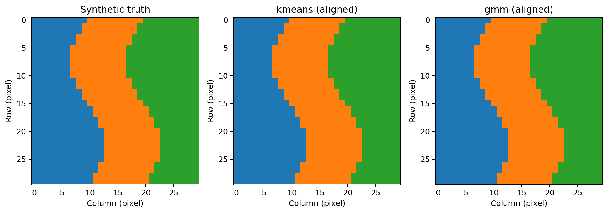
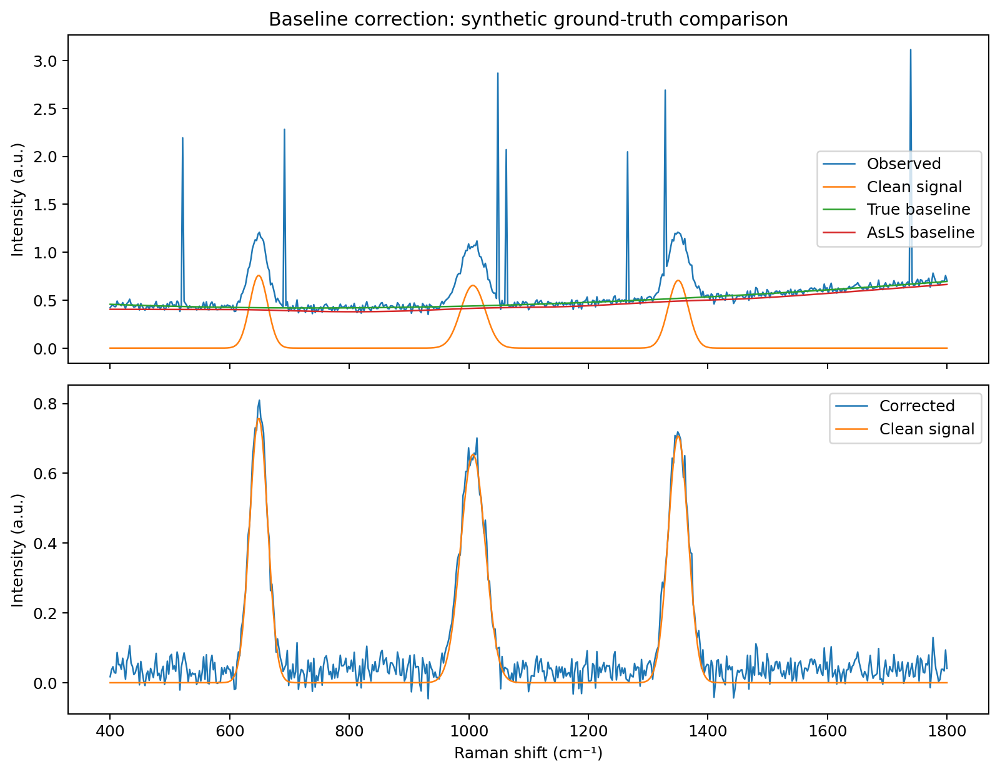

# RamanSpec-MineralML

A reproducible Python research demonstration of synthetic Raman-like spectral simulation,
artifact removal, sparse baseline correction, PCA, and unsupervised classification.
Developed for learning computational spectroscopy and numerical methods by Gabriel
Chiazor Unomah.

**All spectra and class signatures are synthetic.** No experimental measurements,
validated mineral identities, compositions, or fluid–melt partition coefficients
are reported. Class 0, 1, and 2 are invented spectral populations.

## Motivation and capabilities

Spectral preprocessing and geophysical inversion share a practical problem: useful
structure must be separated from noise and nuisance effects without deleting the
signal. This project explores that problem with known synthetic ground truth.

- Gaussian peaks with varying positions, widths and amplitudes; fluorescence-like
  baselines, Gaussian noise, sparse positive spikes, and a 30 × 30 spatial layout.
- Local median / scaled MAD despiking and sparse Asymmetric Least Squares (AsLS).
- Explicit nonfinite-value policies, vector normalization and optional standardization.
- PCA scores and loadings; reproducible k-Means and full-covariance GMM models.
- ARI, silhouette, spike precision/recall, baseline RMSE, peak preservation,
  AsLS sensitivity, noise comparisons, AIC/BIC and spatial maps.
- Lossless ground truth and processed arrays, CSV/JSON metrics, 13 PNG figures,
  provenance and a Markdown report. No GPU, API keys or external datasets needed.

## Install and run

Use Python 3.11 or 3.12. From the repository root:

```bash
python -m venv .venv
# Windows PowerShell:
.venv\Scripts\Activate.ps1
# macOS/Linux instead: source .venv/bin/activate
python -m pip install --upgrade pip
python -m pip install -e ".[dev]"
python -m ramanspec demo --output results
python -m pytest -q
```

If PowerShell activation is restricted, use `.venv\Scripts\python.exe` in place of
`python`; changing system execution policy is unnecessary. For tested direct
dependency versions, use `python -m pip install -r requirements-tested.txt` before
the editable install. This is a tested version snapshot, not a complete transitive
lockfile. See [Windows steps](LEARNING_GUIDE.md#windows-workflow).

Run `python -m ramanspec demo --help` for seed, noise, component and cluster options.
Use `--skip-noise-sweep` for a shorter run. The default pipeline uses five PCs,
three clusters, vector normalization, and no channel standardization. The optional
standardization API is `preprocess(data, standardize=True)`.

## Start exploring

1. Open `results/reports/summary.md` after the demo.
2. Inspect `results/figures/baseline_correction.png`, `pca_scores_truth.png`, and
   `spatial_maps.png`. The maps align predicted IDs to ground truth for color
   comparison only; clustering never receives truth labels or spatial coordinates.
3. Read [LEARNING_GUIDE.md](LEARNING_GUIDE.md) and work through the notebooks in order.
4. Consult [RESEARCH_METHODS.md](RESEARCH_METHODS.md) and
   [INTERVIEW_PREPARATION.md](INTERVIEW_PREPARATION.md).




These are selected figures from the executed default synthetic experiment. The
complete regenerable dataset and results are ignored by Git to keep the repository
small. A small example spectral CSV is retained under `data/synthetic/`.

## Architecture

`src/ramanspec/` contains simulation, baseline, despiking, preprocessing,
dimensionality, clustering, validation, visualization and pipeline modules. The
extra `pipeline.py` keeps orchestration and file exports separate from reusable
numerical functions. `__main__.py` implements the CLI; `scripts/run_demo.py` is a
convenience wrapper. `tests/` covers numerical behavior and end-to-end exports.
`notebooks/` has four progressive executable lessons. GitHub Actions tests Python
3.11/3.12 on Ubuntu and Windows. CI configuration is provided; a local test pass
is not a claim that remote CI has run.

## Reproducibility and mathematics

Default configuration: seed 42; 900 spectra; 601 equally spaced channels from 400
to 1800 cm⁻¹; three classes; 30 × 30 pixels. A local NumPy generator controls the
simulation; PCA, k-Means and GMM receive explicit seeds. Repeating a configuration
in the same software environment reproduces equivalent numerical outputs; binary
PNG/ZIP identity and bitwise agreement across BLAS implementations are not promised.
`results/reports/provenance.json` records parameters and actual library versions.

The measurement model is `y = s + b + ε + c`. AsLS solves
`(W + λ DᵀD)z = Wy` with sparse matrices; PCA reduces centered spectra by SVD;
k-Means minimizes within-cluster squared distances; GMM fits a weighted sum of
Gaussian densities. Full derivations and assumptions are in the methods guide.

## Limits and future work

The classes are intentionally separable, K=3 is known from the generator, and
single-seed noise experiments are descriptive rather than uncertainty estimates.
The spike detector can remove unresolved real peaks. Baseline settings depend on
sampling and peak widths. GMM probabilities are not calibrated mineral confidence.
High ARI here does not establish mineral identification on experimental spectra.

Future work includes multi-seed uncertainty estimates, alternative peak shapes,
real-data import with calibration and provenance, held-out validation, spatially
aware models, and co-registered Raman–EDS comparisons with independently verified
reference materials. The existing MIT license applies.
